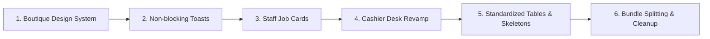
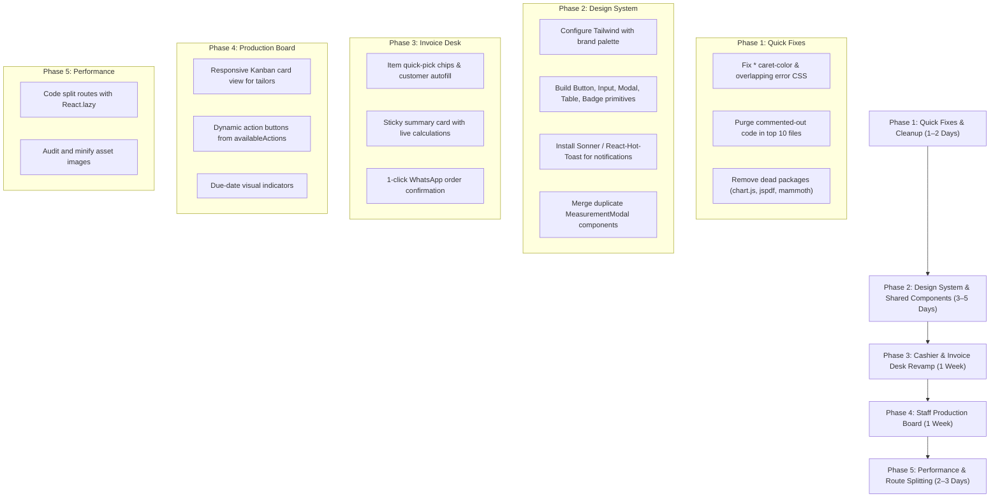

# Frontend UI & UX Enhancement Plan: Saritha Fashion Studio

This document provides a comprehensive UI/UX audit, architectural critique, and actionable design roadmap for modernizing the frontend application (`SarithaFashion_Frontend/src`).

---

## 1. Executive Summary & Audit Findings

The current frontend is operational following the backend migration, but suffers from **visual fragmentation, dead code overhead, and usability hurdles** on the shop floor.

### Key Observations
* **Visual Inconsistency:** Four conflicting color schemes and styling approaches coexist across screens:
  * Bright magenta header (`#FFBFF9`) with green scrollbars/borders (`#179002`) and purple buttons (`#6E5AF0`).
  * Invoice forms with lavender backgrounds (`#DCD8FB`), sage-green borders (`#A8DCAB`), and heavy dropshadows (`0 4px 4px rgba(0,0,0,0.25)`).
  * Login screen using Tailwind-style slate and indigo (`#6366f1`).
  * Unapplied brand tokens in `index.css` (Maroon `#7B1123`, Rose Gold `#D48B8B`, Gold `#D4AF37`).
* **Rogue CSS Rule Breaking Cursors:** In `NavBar.css`, `* { caret-color: transparent; }` causes text input cursors to become invisible across the entire application unless specifically patched with `caret-color: auto` on each individual input.
* **Alert Interruption Fatigue:** Over **240 SweetAlert (`Swal.fire`)** modal popups interrupt users for non-critical confirmations, copy events, and validation checks.
* **Shop-Floor Usability Gap:** Tailors and assistants operating phones or tablets at cutting tables are presented with 10-column desktop tables requiring excessive pinch-to-zoom and horizontal scrolling instead of touch-friendly cards or Kanban boards.
* **Dead Code Bloat:** Over 10,000 lines of code across major screens are commented out (between 50% and 77% of files like `TailorDashboard.jsx`, `MyOrdersTM.jsx`, and `ReceiptGeneration.jsx`).
* **Unconfigured Styling Infrastructure:** Tailwind CSS is listed in `package.json` (`tailwindcss: ^3.4.18`), but there is no `tailwind.config.js` and the directives (`@tailwind`) are missing from `index.css`. The app relies on 64 uncoordinated, raw CSS files with colliding global class names.

---

## 2. Critical UI Bugs & Styling Conflicts to Fix Immediately

| # | File / Location | Issue | Impact | Recommended Fix |
|---|---|---|---|---|
| **1** | `src/Components/NavBar.css` (`L1-L8`) | `* { caret-color: transparent; }` on the universal selector. | Text typing cursor is completely invisible inside input fields across the app. | Remove `caret-color: transparent;` from `*`. |
| **2** | `src/Pages/PaymentInvoice/ReceiptGeneration/ReceiptGeneration.css` (`L211-L216`) | `.error-message-invoice-field { position: absolute; bottom: -20px; }` | When validation errors trigger, text collides with and obscures the input fields below them. | Use standard inline flow with block margins (`display: block; margin-top: 4px; font-size: 12px; color: #DC2626;`). |
| **3** | `src/App.jsx` (`L148-L163`) | Route names are reversed: `/invoiceGeneration` renders `<ReceiptGeneration />`, while `/receiptGeneration` renders `<InvoiceGeneration />`. | Confusing routing semantics for internal links, navigation badges, and deep links. | Align route paths with component definitions. |
| **4** | Three copies of `MeasurementModal.jsx` | Found in `ReceiptGeneration`, `ViewEditOrder`, and `TailorDashboard`. | The three measurement modals have drifted apart; different screens show different measurement fields for the same garment. | Consolidate into a single reusable component: `src/components/common/MeasurementModal.jsx`. |
| **5** | Global CSS collisions | 64 individual CSS files using generic global names like `.item-row`, `.input-field`, `.active`, `.remove-btn`. | Unintended style overrides when navigating between pages without a full reload. | Adopt CSS Modules (`[name].module.css`) or configure Tailwind utility classes. |

---

## 3. The 6 Pillars for UI/UX Enhancement



### Pillar 1: Establish a Cohesive Boutique Design System
Transform the application into a consistent, premium fashion studio tool:
* **Color Palette:**
  * **Brand Primary:** Deep Studio Maroon (`#7B1123`) or Rich Plum (`#5B142B`).
  * **Surfaces:** Pure White (`#FFFFFF`) with warm light-gray/champagne canvas backgrounds (`#FBF9F7` or `#F8FAFC`).
  * **Accents:** Champagne Rose Gold (`#D48B8B`) and Warm Gold (`#D4AF37`) for boutique badges.
  * **Status Colors:** Clean emerald (`#16A34A` for Paid/Completed), amber (`#D97706` for Partial/Pending), and ruby red (`#DC2626` for Overdue/Dues).
  * **Retire Legacy Palette:** Remove the harsh pink header (`#FFBFF9`), green scrollbars (`#179002`), sage borders (`#A8DCAB`), and inset shadows (`box-shadow: inset ...`).
* **Typography:**
  * **Brand Headings:** Elegant editorial display serif (`Playfair Display` or `Cinzel`).
  * **Interface & Body:** Clean, legible sans-serif (`Inter`, `Plus Jakarta Sans`, or `Jost`) for numbers, tables, forms, and badges.

### Pillar 2: Replace 240+ Blocking SweetAlerts with Modern Toasts
* **Informational & Success Updates:** Replace intrusive modal popups with modern, non-blocking toast notifications (e.g., using `sonner` or `react-hot-toast`).
* **Destructive Confirmation Only:** Restrict dialog modals strictly to high-impact irreversible actions (such as deleting an invoice or removing an employee account).
* **Inline Form Feedback:** Display field-level validation messages directly below the input rather than triggering alert popups on submit.

### Pillar 3: Transform Staff Screens into Mobile/Tablet-First Job Cards
Tailors and shop assistants primarily work on mobile devices or tablets at cutting tables:
* **Kanban / Card View:** Replace sprawling 10+ column desktop tables with responsive cards organized by stage:
  * Garment thumbnail image & category badge (`Blouse`, `Salwar Set`).
  * Due date status badge:
    * 🟢 Normal (>2 days)
    * 🟡 Due Today / Tomorrow
    * 🔴 Overdue
  * Customer name & Assignee name.
* **Touch-Friendly Controls:** Large, thumb-sized action buttons generated dynamically from the backend's `availableActions` (e.g., `[ Mark Cut ]`, `[ Mark Stitched ]`, `[ Mark Ironed ]`).
* **Quick-Access Measurements:** A single tap opens an inspection drawer/sheet with measurement diagrams and design reference images without navigating away from the queue.

### Pillar 4: Streamline the Invoice & Cashier Experience
Enhance `ReceiptGeneration.jsx` to maximize cashier speed during busy counter hours:
1. **Autofill Customer Search:** Typing a 10-digit mobile number automatically searches existing customers, displaying their total visits, outstanding balance/dues, and offering their latest saved measurements.
2. **Item Quick-Pick Chips:** Provide one-click chips for top-selling items (`Blouse`, `Salwar Set`, `Lining Material`, `Saree Fall/Pico`) to avoid manually selecting from dropdowns.
3. **Sticky Financial Summary Card:** A dedicated sidebar/bottom sheet displaying real-time calculations: Subtotal, GST (derived from backend rules), Advance Paid, and Remaining Balance Due.
4. **Instant WhatsApp Notification:** A 1-click button to trigger a pre-formatted WhatsApp payment reminder and invoice download link directly to the customer.

### Pillar 5: Standardized Tables, Skeletons, and Empty States
* **Shared Table Component:** Implement sticky headers, sortable columns, server-side pagination, and CSV export across all views.
* **Skeleton Loaders:** Replace abrupt loading spinners or blank screens with pulsating skeleton placeholders that preserve layout structure during data fetching.
* **Rich Empty States:** Replace generic "no data found" placeholders with contextual empty screens (e.g., *"No deliveries due today 🎉"* with an action to inspect tomorrow's schedule).
* **Unified Formatting:**
  * Currency: Standard `Intl.NumberFormat('en-IN', { style: 'currency', currency: 'INR' })` (`₹1,250.00`).
  * Date/Time: Uniform IST display (`17 Nov 2026, 02:30 PM`).

### Pillar 6: Performance, Code Cleanup & Bundle Splitting
* **Purge Dead Code:** Remove over 10,000 lines of commented-out legacy code that clutter the repository and risk regressions during automated refactoring.
* **Prune Unused Dependencies:** Remove packages installed but never imported:
  * `chart.js`, `react-chartjs-2`, `jspdf`, `html2canvas`, `mammoth`, `run`.
* **Consolidate Lottie Libraries:** Remove `react-lottie` and standardize exclusively on `lottie-react`.
* **Route Lazy-Loading:** Implement `React.lazy()` and `Suspense` in `App.jsx` to split the current 2.8 MB monolithic JS bundle into lightweight per-role bundles.

---

## 4. Design System Tokens & Color Reference

```css
:root {
  /* Brand Identity */
  --brand-primary: #7B1123;         /* Deep Studio Maroon */
  --brand-primary-hover: #5F0C1A;   /* Darkened Maroon */
  --brand-accent-gold: #D4AF37;     /* Warm Gold */
  --brand-accent-rose: #D48B8B;     /* Muted Rose Gold */

  /* Neutral Backgrounds & Canvas */
  --bg-page: #F8FAFC;               /* Light Canvas */
  --bg-surface: #FFFFFF;            /* White Cards & Panels */
  --bg-surface-subtle: #F1F5F9;     /* Subtle Muted Surface */
  --border-subtle: #E2E8F0;         /* Clean 1px Card/Input Border */
  --border-focus: #7B1123;          /* Active Field Focus Ring */

  /* Typography */
  --text-main: #0F172A;             /* Slate 900 for high contrast */
  --text-muted: #64748B;            /* Slate 500 for secondary text */
  --text-inverse: #FFFFFF;

  /* Functional Status Badges */
  --status-paid-bg: #DCFCE7;
  --status-paid-text: #15803D;
  --status-partial-bg: #FEF3C7;
  --status-partial-text: #B45309;
  --status-overdue-bg: #FEE2E2;
  --status-overdue-text: #B91C1C;
}
```

---

## 5. Screen-by-Screen UI Enhancement Blueprint

### 5.1 App Shell & Navigation
* **Desktop Sidebar:** Replace the current fixed top bar with a collapsible left navigation rail displaying the shop logo, active shop switcher (for platform owners), role-specific links, and user profile drawer.
* **Mobile Header & Bottom Navigation:** On screens smaller than 768px, render a slim header with a hamburger drawer and a fixed bottom navigation bar for quick access to primary actions (Deliveries, New Invoice, Queue).

### 5.2 Invoice & Payment Screen (`ReceiptGeneration.jsx`)
* **Layout:** Two-column desktop grid (Left: Customer & Garment Items list; Right: Sticky Order Summary & Payment collection).
* **Customer Card:** Input mobile number $\rightarrow$ inline badge shows *"Returning customer: 4 previous orders, ₹0 due"* $\rightarrow$ pre-fills customer name automatically.
* **Garment Lines:** Item rows styled as clean card segments with thumbnail upload, measurement trigger badge, and line item total.

### 5.3 Staff Queue & Production Board (`TailorDashboard.jsx` / `MyOrdersTM.jsx`)
* **Layout:** Tabbed views for **Board (Kanban)** and **List (Table)**.
* **Status Columns:** `RECEIVED` $\rightarrow$ `CUTTING` $\rightarrow$ `STITCHING` $\rightarrow$ `IRONING` $\rightarrow$ `READY_FOR_DELIVERY`.
* **Card Details:** High-contrast delivery deadline countdown, client name, item specification, and action buttons.

### 5.4 Owner Dashboard (`MenuBar.jsx` & Financials)
* **Metrics Banner:** Clean KPI cards showing Period Invoiced, Period Collected, Petty Cash Balance, and Outstanding Dues.
* **Interactive Filtering:** Period selector (Today, This Week, This Month, Custom Date Range) that updates all cards and charts simultaneously.

---

## 6. Phased Implementation Plan


