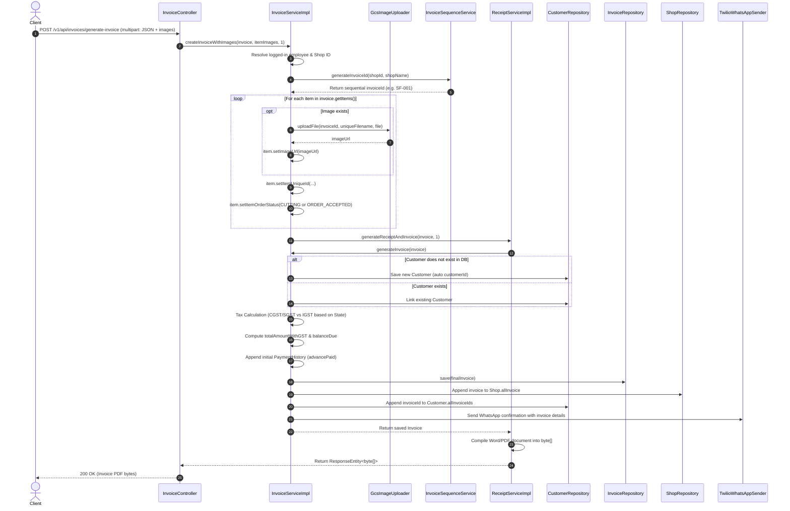

# Invoice and Item Creation Flow Documentation

This document explains the architecture, files, item handling logic, and complete end-to-end execution flow for creating invoices in the Saritha Fashion Backend.

---

## 1. Key Files Involved

| Component | File Path | Responsibility |
|---|---|---|
| **Controller** | [`InvoiceController.java`](file:///C:/Users/ARUL%20S/Downloads/SarithaFashion_Backend/SarithaFashion_Backend/src/main/java/com/saritha/fashions/controller/InvoiceController.java) | Exposes `POST /v1/api/invoices/generate-invoice` (multipart) and `POST /v1/api/invoices/generate` (JSON). |
| **Service Interface** | [`InvoiceService.java`](file:///C:/Users/ARUL%20S/Downloads/SarithaFashion_Backend/SarithaFashion_Backend/src/main/java/com/saritha/fashions/service/Interface/InvoiceService.java) | Contract for invoice creation (`createInvoiceWithImages`, `generateInvoice`) and item updates (`updateInvoiceItems`). |
| **Service Implementation** | [`InvoiceServiceImpl.java`](file:///C:/Users/ARUL%20S/Downloads/SarithaFashion_Backend/SarithaFashion_Backend/src/main/java/com/saritha/fashions/service/InvoiceServiceImpl.java) | Core business logic: sequence generation, item processing, image upload, tax calculation, persistence, customer linking, and notifications. |
| **Item Model** | [`Items.java`](file:///C:/Users/ARUL%20S/Downloads/SarithaFashion_Backend/SarithaFashion_Backend/src/main/java/com/saritha/fashions/payload/items/Items.java) | Embedded document representing individual tailoring items, measurements, pricing, status, and tailor assignment. |
| **Invoice Model** | [`Invoice.java`](file:///C:/Users/ARUL%20S/Downloads/SarithaFashion_Backend/SarithaFashion_Backend/src/main/java/com/saritha/fashions/model/Invoice.java) | MongoDB document (`invoice` collection) containing customer ref, items list, tax/financial breakdown, and status. |
| **Sequence Service** | [`InvoiceSequenceService.java`](file:///C:/Users/ARUL%20S/Downloads/SarithaFashion_Backend/SarithaFashion_Backend/src/main/java/com/saritha/fashions/service/InvoiceSequenceService.java) | Generates sequential, shop-prefixed invoice identifiers. |
| **Storage Service** | [`GcsImageUploader.java`](file:///C:/Users/ARUL%20S/Downloads/SarithaFashion_Backend/SarithaFashion_Backend/src/main/java/com/saritha/fashions/util/GcsImageUploader.java) | Uploads item reference images to Google Cloud Storage (GCS). |
| **Receipt / PDF Service** | [`ReceiptServiceImpl.java`](file:///C:/Users/ARUL%20S/Downloads/SarithaFashion_Backend/SarithaFashion_Backend/src/main/java/com/saritha/fashions/service/ReceiptServiceImpl.java) | Coordinates invoice generation and compiles the Word/PDF document. |
| **Notification Service** | [`TwilioWhatsAppSender.java`](file:///C:/Users/ARUL%20S/Downloads/SarithaFashion_Backend/SarithaFashion_Backend/src/main/java/com/saritha/fashions/service/Custom/TwilioWhatsAppSender.java) | Sends WhatsApp confirmation messages to the customer phone number. |
| **Activity Tracking** | [`EmployeeActivityService.java`](file:///C:/Users/ARUL%20S/Downloads/SarithaFashion_Backend/SarithaFashion_Backend/src/main/java/com/saritha/fashions/service/Interface/EmployeeActivityService.java) | Records audit logs for invoice creation by employee. |

---

## 2. Where and How Invoice Items Are Created

Invoice items are defined in **[`Items.java`](file:///C:/Users/ARUL%20S/Downloads/SarithaFashion_Backend/SarithaFashion_Backend/src/main/java/com/saritha/fashions/payload/items/Items.java)** and processed in **[`InvoiceServiceImpl.java`](file:///C:/Users/ARUL%20S/Downloads/SarithaFashion_Backend/SarithaFashion_Backend/src/main/java/com/saritha/fashions/service/InvoiceServiceImpl.java#L1896-L2005)**.

### Item Structure (`Items.java`)
Each item in `Invoice.items` holds:
- `itemUniqueId`: Unique string identifier generated per item (e.g. `Blouse_1700000000000_0`).
- `itemName`: Name/category of the tailoring item (e.g. `Blouse`, `Embroidery`, `Chudidhar`).
- `itemQuantity` & `itemPrice`: Quantity and unit price.
- `imageUrl`: Public GCS URL if a design image is attached.
- `itemOrderStatus`: Current progress status (`ORDER_ACCEPTED`, `CUTTING`, etc.).
- `assignmentStatus`: Status of assignment to tailors.
- `assignedTo`: Tailor ID assigned to this item.
- `assignedToWhichShopAssistant`: Shop assistant ID assigned to this item.
- `measurements`: Key-value map of tailoring measurements.
- `measurementList`: Structured measurements (`name`, `value`, `unit`).
- `assignmentHistory`: Audit history of assignments for this specific item.

### Item Creation Logic in `InvoiceServiceImpl.createInvoiceWithImages`
Located at lines 1896–2005 of `InvoiceServiceImpl.java`:

1. **Image Association:**
   - Client sends multipart files named `item_{index}_{name}.ext`.
   - The method parses the index and matches each image with `invoice.getItems().get(i)`.
2. **GCS Upload:**
   - For each matched image, generates a sanitized unique filename:
     ```java
     String timestamp = String.valueOf(System.currentTimeMillis());
     String safeItemName = item.getItemName().replaceAll("[^a-zA-Z0-9]", "_");
     String uniqueFilename = String.format("%s_%s_%d", safeItemName, timestamp, i);
     String imageUrl = gcsImageUploader.uploadFile(invoiceId, uniqueFilename, file);
     item.setImageUrl(imageUrl);
     ```
3. **Item Unique ID Generation:**
   - `item.setItemUniqueId(uniqueFilename)` is assigned to ensure every item has a unique, queryable identifier.
4. **Automated Order Status Determination:**
   - Special category items (`Embroidery`, `Lining Material`, `Saree Fall`, `Saree Pico`, `Designing`) skip initial waiting and are auto-assigned:
     ```java
     item.setItemOrderStatus(OrderStatus.CUTTING);
     ```
   - Standard tailoring items receive:
     ```java
     item.setItemOrderStatus(OrderStatus.ORDER_ACCEPTED);
     ```

---

## 3. End-to-End Invoice Creation Flow



---

## 4. Step-by-Step Flow Explanation

### Step 1: Entry Point & Request Ingestion
- Endpoint: `POST /v1/api/invoices/generate-invoice` in [`InvoiceController.java`](file:///C:/Users/ARUL%20S/Downloads/SarithaFashion_Backend/SarithaFashion_Backend/src/main/java/com/saritha/fashions/controller/InvoiceController.java#L150).
- Accepts multipart request parts:
  - `invoiceJson`: JSON string representing the `Invoice` payload.
  - `images`: Optional list of `MultipartFile` item reference images.
- Jackson `ObjectMapper` deserializes `invoiceJson` into the `Invoice` model.

### Step 2: Shop & Employee Context Resolution
- Inside [`InvoiceServiceImpl.createInvoiceWithImages`](file:///C:/Users/ARUL%20S/Downloads/SarithaFashion_Backend/SarithaFashion_Backend/src/main/java/com/saritha/fashions/service/InvoiceServiceImpl.java#L1869):
  - Fetches logged-in employee via `authUtil.loggedInUser()`.
  - Queries MongoDB `shops` collection for the shop containing this employee's ID in `employeeIds`.
  - Throws `APIException("Shop Not found")` if unassigned.

### Step 3: Sequential Invoice Number Generation
- Invokes [`InvoiceSequenceService.generateInvoiceId(shopId, shopName)`](file:///C:/Users/ARUL%20S/Downloads/SarithaFashion_Backend/SarithaFashion_Backend/src/main/java/com/saritha/fashions/service/InvoiceSequenceService.java).
- Atomically increments sequence counter in MongoDB (`invoice_sequences` collection) and prefixes shop code.

### Step 4: Items Processing & Image Upload
- Matches each image filename (`item_{index}_{name}.ext`) to corresponding item.
- Uploads images to Google Cloud Storage (`GcsImageUploader`).
- Generates `itemUniqueId` for every item using format: `{safeItemName}_{timestamp}_{index}`.
- Categorizes status:
  - Excluded items (`"Embroidery"`, `"Lining Material"`, `"Saree Fall"`, `"Saree Pico"`, `"Designing"`) &rarr; `CUTTING`.
  - Others &rarr; `ORDER_ACCEPTED`.

### Step 5: Customer Lookup or Creation
- In [`InvoiceServiceImpl.generateInvoice`](file:///C:/Users/ARUL%20S/Downloads/SarithaFashion_Backend/SarithaFashion_Backend/src/main/java/com/saritha/fashions/service/InvoiceServiceImpl.java#L1015-L1027):
  - If `customer.getId()` is null, queries `customerRepository.findByPhone(customer.getPhone())`.
  - If new: generates `CUS-` customer ID and saves into `CustomerRepository`.
  - If exists: re-uses existing customer entity.

### Step 6: GST and Financial Computation
- **Taxable Amount:** `totalAmount - discount`.
- **HSN / SAC Codes:** SAC `9988`, HSN `998821`.
- **State Check:**
  - If `customerState.equalsIgnoreCase(shopState)` (Intra-state, default Tamil Nadu):
    - CGST = 2.5%
    - SGST = 2.5%
    - IGST = 0%
  - If inter-state:
    - IGST = 5.0%
    - CGST = 0%, SGST = 0%
- **Balance Due:** `totalAmountWithTax - advancePaid`.
- **Payment Status:**
  - `advancePaid == 0` &rarr; `"Dues"`
  - `balanceDue > 0` &rarr; `"Partial"`
  - `balanceDue <= 0` &rarr; `"Paid"`
- **Payment History:** Adds initial payment record with timestamp and method (`Cash`, `UPI`, `Card`, etc.).

### Step 7: Persistence & Bidirectional Linking
- Saves invoice document: `invoiceRepository.save(finalInvoice)`.
- Appends invoice to `Shop.allInvoice` and updates the shop.
- Appends `invoiceId` to `Customer.allInvoiceIds` and updates the customer document.
- Records employee activity log via `employeeActivityService.recordActivity(...)`.

### Step 8: WhatsApp Alert & Document Generation
- Asynchronously sends a confirmation message via Twilio WhatsApp Sender (`+91` customer phone).
- Calls `receiptService.generateReceiptAndInvoice(invoice, 1)`:
  - Merges invoice and customer data into the Word/PDF template (`Invoice_SF.docx`).
  - Converts and returns the generated PDF `byte[]` to the client.
